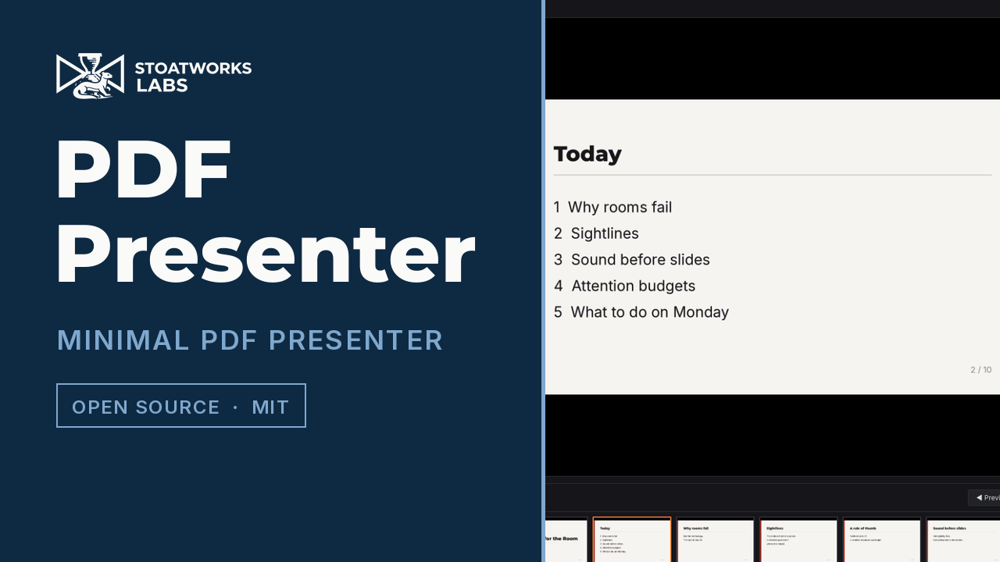
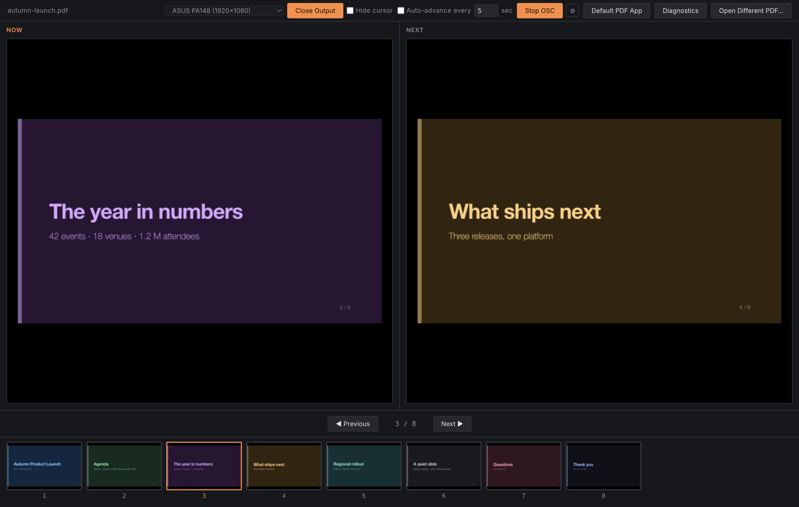
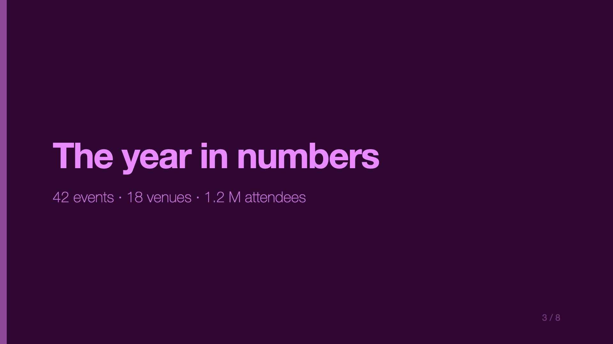
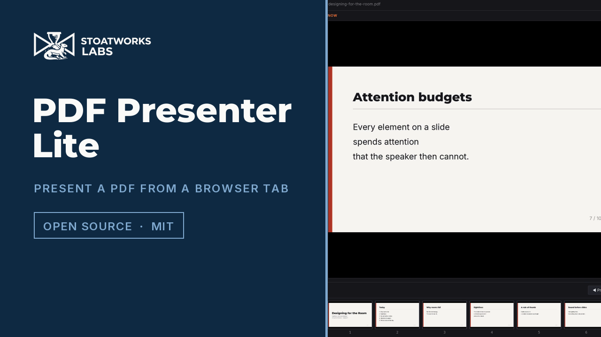

# PDF Presenter

> **AI-assisted project.** This codebase was created with [Claude](https://claude.com/claude-code)
> (Anthropic), directed and reviewed by a human author — including architecture,
> implementation, and documentation. Check it over before you rely on it for a show.

A presenter that does one job. Open a PDF and you get a presenter view on one screen (Now and
Next, plus a strip of slide thumbnails you can click) and a clean fullscreen output on the
second. It doesn't do a notes panel, NDI or network integrations. It's a stripped-down sibling of
[presentation-commander-client](https://github.com/stoatworks-labs/presentation-commander-client),
keeping only its proven pdf.js rendering pipeline and its multi-window/display-picker
pattern.

It comes in two forms, from this one repo. **PDF Presenter** is the desktop app, with the whole
feature set, OSC and the desktop integrations included. **PDF Presenter Lite** is the hosted
build at
[pdf-presenter-lite.stoatworks-labs.com](https://pdf-presenter-lite.stoatworks-labs.com):
the same presenter view in a browser tab with nothing to install, minus the bits a web page
can't do. That difference is all the "Lite" means; the two share their entire UI.

[](https://www.youtube.com/watch?v=iNfjQ8ZmH-M)

*A 48-second tour. That's the app itself presenting an actual PDF, driven over its own OSC
control surface.*





<!-- downloads:start -->

## Download

**[v1.7.2](https://github.com/stoatworks-labs/pdf-presenter/releases/tag/v1.7.2)** — prebuilt for macOS, Windows and Linux. Pick your platform:

<details>
<summary><b>macOS</b> — Universal (Apple Silicon + Intel), Apple Silicon, Intel</summary>

| Build | Download | Size |
| --- | --- | --- |
| Universal (Apple Silicon + Intel) · .dmg disk image | [`pdf-presenter-1.7.2-universal.dmg`](https://github.com/stoatworks-labs/pdf-presenter/releases/download/v1.7.2/pdf-presenter-1.7.2-universal.dmg) | 231 MB |
| Apple Silicon · .dmg disk image | [`pdf-presenter-1.7.2-arm64.dmg`](https://github.com/stoatworks-labs/pdf-presenter/releases/download/v1.7.2/pdf-presenter-1.7.2-arm64.dmg) | 129 MB |
| Intel · .dmg disk image | [`pdf-presenter-1.7.2-x64.dmg`](https://github.com/stoatworks-labs/pdf-presenter/releases/download/v1.7.2/pdf-presenter-1.7.2-x64.dmg) | 136 MB |
| Universal (Apple Silicon + Intel) · .pkg installer | [`pdf-presenter-lite-1.7.2-macos-universal.pkg`](https://github.com/stoatworks-labs/pdf-presenter/releases/download/v1.7.2/pdf-presenter-lite-1.7.2-macos-universal.pkg) | 231 MB |
| Apple Silicon · .pkg installer | [`pdf-presenter-lite-1.7.2-macos-arm64.pkg`](https://github.com/stoatworks-labs/pdf-presenter/releases/download/v1.7.2/pdf-presenter-lite-1.7.2-macos-arm64.pkg) | 129 MB |
| Intel · .pkg installer | [`pdf-presenter-lite-1.7.2-macos-x64.pkg`](https://github.com/stoatworks-labs/pdf-presenter/releases/download/v1.7.2/pdf-presenter-lite-1.7.2-macos-x64.pkg) | 136 MB |
| Universal (Apple Silicon + Intel) · .zip archive | [`PDF.Presenter-1.7.2-universal-mac.zip`](https://github.com/stoatworks-labs/pdf-presenter/releases/download/v1.7.2/PDF.Presenter-1.7.2-universal-mac.zip) | 231 MB |
| Apple Silicon · .zip archive | [`PDF.Presenter-1.7.2-arm64-mac.zip`](https://github.com/stoatworks-labs/pdf-presenter/releases/download/v1.7.2/PDF.Presenter-1.7.2-arm64-mac.zip) | 130 MB |
| Intel · .zip archive | [`PDF.Presenter-1.7.2-mac.zip`](https://github.com/stoatworks-labs/pdf-presenter/releases/download/v1.7.2/PDF.Presenter-1.7.2-mac.zip) | 136 MB |

</details>

<details>
<summary><b>Windows</b> — x64 & ARM64, x64, ARM64</summary>

| Build | Download | Size |
| --- | --- | --- |
| x64 & ARM64 · .exe installer | [`pdf-presenter-1.7.2-setup.exe`](https://github.com/stoatworks-labs/pdf-presenter/releases/download/v1.7.2/pdf-presenter-1.7.2-setup.exe) | 220 MB |
| x64 · .exe installer | [`pdf-presenter-1.7.2-x64-setup.exe`](https://github.com/stoatworks-labs/pdf-presenter/releases/download/v1.7.2/pdf-presenter-1.7.2-x64-setup.exe) | 113 MB |
| ARM64 · .exe installer | [`pdf-presenter-1.7.2-arm64-setup.exe`](https://github.com/stoatworks-labs/pdf-presenter/releases/download/v1.7.2/pdf-presenter-1.7.2-arm64-setup.exe) | 107 MB |
| x64 & ARM64 · portable .exe | [`pdf-presenter-1.7.2-portable.exe`](https://github.com/stoatworks-labs/pdf-presenter/releases/download/v1.7.2/pdf-presenter-1.7.2-portable.exe) | 220 MB |
| x64 · portable .exe | [`pdf-presenter-1.7.2-x64-portable.exe`](https://github.com/stoatworks-labs/pdf-presenter/releases/download/v1.7.2/pdf-presenter-1.7.2-x64-portable.exe) | 113 MB |
| ARM64 · portable .exe | [`pdf-presenter-1.7.2-arm64-portable.exe`](https://github.com/stoatworks-labs/pdf-presenter/releases/download/v1.7.2/pdf-presenter-1.7.2-arm64-portable.exe) | 107 MB |

</details>

<details>
<summary><b>Linux</b> — x64, ARM64</summary>

| Build | Download | Size |
| --- | --- | --- |
| x64 · .deb package (Debian/Ubuntu) | [`pdf-presenter_1.7.2_amd64.deb`](https://github.com/stoatworks-labs/pdf-presenter/releases/download/v1.7.2/pdf-presenter_1.7.2_amd64.deb) | 101 MB |
| ARM64 · .deb package (Debian/Ubuntu) | [`pdf-presenter_1.7.2_arm64.deb`](https://github.com/stoatworks-labs/pdf-presenter/releases/download/v1.7.2/pdf-presenter_1.7.2_arm64.deb) | 96 MB |
| x64 · .rpm package (Fedora/RHEL) | [`pdf-presenter-1.7.2.x86_64.rpm`](https://github.com/stoatworks-labs/pdf-presenter/releases/download/v1.7.2/pdf-presenter-1.7.2.x86_64.rpm) | 91 MB |
| ARM64 · .rpm package (Fedora/RHEL) | [`pdf-presenter-1.7.2.aarch64.rpm`](https://github.com/stoatworks-labs/pdf-presenter/releases/download/v1.7.2/pdf-presenter-1.7.2.aarch64.rpm) | 86 MB |

</details>

All builds, checksums and release notes: [github.com/stoatworks-labs/pdf-presenter/releases](https://github.com/stoatworks-labs/pdf-presenter/releases).

macOS builds are signed and notarised and open normally. The Windows builds are unsigned, so SmartScreen warns once — see [Windows SmartScreen & Defender Firewall](#windows-smartscreen--defender-firewall) for the one-time click-through.

<!-- downloads:end -->

> **v1.3.1 predates the rename.** It was released as *PDF Presenter Lite*, so its
> files are named `pdf-presenter-lite-1.3.1-…` and it installs as
> `PDF Presenter Lite.app` / `PDF Presenter Lite.exe`. Everything below describes
> the app by its current name, which it has carried since v1.4.0. The hosted
> build keeps the old name for good: see
> [Run it in a browser](#run-it-in-a-browser-with-nothing-installed--pdf-presenter-lite).

## What it does

- **Open a PDF**: it renders locally with pdf.js, with no other slide-source integrations
- **Presenter view**: a "Now" and "Next" preview side by side, with a horizontal strip of
  thumbnails for every slide below them. Click any thumbnail to jump straight to that slide
- **Keyboard navigation**: Left/Right, Up/Down and Page Up/Page Down all move a slide, and
  Space also advances. The same keys work whether the presenter view or the fullscreen Output
  window has focus, so a presentation clicker keeps working on a single-display machine, or
  after a stray click moves focus to the Output window
- **Mouse navigation**: a Previous/Next transport bar below the thumbnail strip, and clicking
  the "Next" preview itself jumps straight to it
- **Internal PDF link navigation**: links authored into the PDF itself (a table of contents,
  "back to agenda" links exported from PowerPoint/Keynote/Google Slides) become clickable on
  the "Now" slide and jump straight to their target page. It reads link annotations through
  pdf.js and resolves each destination to a page number, whether it's a named or an explicit
  destination. Only internal same-document links are wired up; external URLs are left alone
- **Fullscreen Output window**: a second, chrome-free window showing just the current slide,
  for a projector or confidence monitor. Pick which connected display it opens on from a
  dropdown next to the toggle button. The two windows have different names in the window
  switcher, "PDF Presenter — Control" and "PDF Presenter — Output (<display>)"
- **Screen blanking**: press `B` or `W` to cut the Output window to solid black or white
  without losing your place, the same as PowerPoint's presenter shortcuts. Press again to
  bring the slide back
- **Hide cursor on Output**: an optional checkbox that hides the OS mouse cursor whenever it's
  over the Output window, so the audience-facing screen stays clean
- **OSC control**: a UDP OSC address space (slide navigation, black/white, Output open/close,
  system enable/disable) at `/pdfpresenter/...`. It's plain UDP rather than a Windows COM
  add-in, so it works on every platform this app ships for. A Bitfocus Companion module ships
  alongside it,
  [companion-module-pdf-presenter-lite](https://github.com/stoatworks-labs/companion-module-pdf-presenter-lite),
  for driving it from a Stream Deck or any other Companion surface. An optional, off-by-default
  "watched folder" feature lets OSC open a specific PDF by filename without a dialog, which is
  handy for a button wall that loads a particular deck on cue. Sections come from the PDF's own
  top-level outline/bookmarks, and `goto/section` jumps straight to one.
  `/pdfpresenter/slideshow/laserpointer` mirrors the presenter's mouse position over the "Now"
  preview onto the Output window as a glowing dot, like PowerPoint's own laser pointer.
  `/pdfpresenter/slideshow/setwallpaper` renders the current slide and sets it as the desktop
  wallpaper on every connected monitor. macOS and Windows are fully covered; Linux is
  GNOME-only
- **Slide transitions**: one global transition for the whole deck. There's no per-slide
  setting, because a PDF has nowhere to store one, and a presenter picks a look once anyway.
  Cut, fade, dip to black, dip to white, and push, wipe, cover and uncover from any of the four
  sides or four corners, or **dynamic**, which comes from the left when advancing and from the
  right when stepping back, plus zoom. The duration is global too, in milliseconds. **Only the
  Output window transitions**: the presenter's Now/Next panes always cut, so the operator is
  never watching an animation instead of the truth. You can set it remotely with
  `/pdfpresenter/slideshow/transition/seteffect`, `/setdirection` and `/setduration`, and it's
  reported back on `/pdfpresenter/slideshow/transition*`
- **Timed auto-advance**: an optional "advance every N seconds" mode (it stops at the last
  slide rather than looping), with its own play/pause control next to the OSC settings.
  `/pdfpresenter/slideshow/pause` and `/resume` suspend and resume it remotely once it's
  turned on
- **Set as Default PDF App**: a titlebar button so double-clicking a PDF opens it straight in
  this app. What it does depends on the OS, since neither Windows nor macOS lets a third-party
  app take over the default-app slot without asking. On Windows it registers the app as a
  candidate, then opens Settings for you to confirm. On macOS it registers with Launch Services
  and sets the default directly if `duti` is installed (`brew install duti`), and otherwise
  shows the real manual steps. On Linux it's fully automatic via `xdg-mime`. The status message
  always says what actually happened, never a fake "done" when the real answer is "you still
  need to confirm it"

## Run it in a browser, with nothing installed — *PDF Presenter Lite*

Everything above renders with pdf.js (the desktop app never did that part natively), so the
presenter view works just as well as a **hosted web app** with no backend at all. Build it with
`npm run static:build` and publish the result as static assets (a Cloudflare Worker, in my
case).

This build calls itself **PDF Presenter Lite**. The "Lite" is the difference in the table
below, and the name is in the app's own titlebar, so an operator can tell at a glance which one
is on the screen.

**Your PDF is never uploaded.** There's no server and no upload endpoint: the page reads the
file from your own disk, and the deck, the thumbnails and the Output window all stay inside
your browser. It's live at
**[pdf-presenter-lite.stoatworks-labs.com](https://pdf-presenter-lite.stoatworks-labs.com)**.

[](https://www.youtube.com/watch?v=5gxPD5JmbzU)

*A 47-second tour of the hosted build, filmed at that address: a deck opened from disk, Now
and Next, the thumbnail strip, then the Output window on top of it. The deck was made up for
these videos, so nobody else's slides appear in it.*

| | Desktop app | Browser |
|---|---|---|
| Presenter view, thumbnails, transport | ✅ | ✅ |
| Fullscreen Output window | ✅ chosen display, opened fullscreen | ✅ popup you place, click to fullscreen |
| Keyboard / clicker, incl. from the Output window | ✅ | ✅ |
| Screen blanking, laser pointer, hide cursor | ✅ | ✅ |
| Internal PDF links, sections, auto-advance | ✅ | ✅ |
| **OSC control** (+ Companion module) | ✅ | ❌ |
| **Watched folder** | ✅ | ❌ |
| Set as default PDF app, wallpaper export | ✅ | ❌ |
| Diagnostics bundle | ✅ | ❌ |

The missing bits all come down to the same limitation: a web page has no UDP socket, no
path-addressable filesystem and no say over the desktop it runs on. The browser build hides
those controls rather than showing buttons that can't work. **If you drive the show from a
Stream Deck, use the desktop app.**

Two differences worth knowing about the browser Output window. It opens as a **pop-up**, so
allow pop-ups for the site. And it opens as a normal window rather than fullscreen: only a
gesture inside a window can make that window fullscreen, so it shows a "Click for fullscreen"
prompt, and there's no getting out of that click. Nothing the opener does can stand in for it.

On Chromium it puts itself on your second display, which needs the Window Management
permission. Refuse that and the window opens wherever the browser would have put it, and you
move it yourself. Either way, the click's the same.

## Architecture

Two renderer views load from the same bundle, picked by a `mode` query param (the same pattern
as the Client Node's Program Out window):

- `App.tsx` is the presenter view. It loads the PDF, owns `currentPage`/`totalPages`, renders
  Now/Next and the thumbnails, and pushes `{ data, currentPage }` to the Output window whenever
  it changes.
- `Output.tsx` is the fullscreen window. It pulls the current state with `output:get-state`
  once its own listener is mounted, rather than relying only on a live push, which can race and
  get dropped without a word if the window's still loading when the presenter pushes. After
  that it stays in sync through `output:state` pushes for as long as it's open.

`pdf.ts` (the PDF loading/rendering helpers) is copied verbatim from
presentation-commander-client, with the same render-queue-per-canvas serialisation to avoid
the transform-corruption bug documented there.

Both views talk to one interface, `PresenterApi` in
[`src/shared/api.ts`](src/shared/api.ts), and two backends implement it:

- [`src/preload/index.ts`](src/preload/index.ts): the Electron IPC bridge.
- [`src/web/browserApi.ts`](src/web/browserApi.ts): the hosted build. The Output window is a
  `window.open` pop-up and the two windows talk over a `BroadcastChannel`, which stands in for
  everything the main process does between them: forwarding state and laser position,
  relaying transport keys pressed while the Output has focus, and holding the last state so an
  Output that finishes loading after a push can pull it (the race mentioned above).

Each backend declares what it can do through `capabilities`, and the components branch on
that, **never on "is this Electron"**.

## Status

**Field proven, both builds.** The desktop app and the hosted browser build (PDF Presenter
Lite) have each been used on real events, not just checked on the bench.

Before that, I built and checked the desktop app end to end: opening a PDF, thumbnail-click
navigation, arrow-key navigation and the fullscreen Output window all worked against a real
multi-page PDF. Testing turned up a real race condition in the initial state hand-off, which
got fixed.

The browser build had the same bench test first, on a dual-display setup against a real
multi-page PDF: the deck loads and renders, the presenter view and thumbnails work, state and
laser position reach a separate Output window, transport keys pressed in the Output window
drive the control window, an Output window loaded *after* a push pulls the current state, and
the Output window opens **on the second display** by itself.

It opens there as a normal window, not fullscreen. That part takes one click, and has to. Only
a gesture inside the window that's going fullscreen can put it there, so no amount of work in
the opener can skip it; the prompt in the Output window is that gesture.

## Inspiration & prior art

The OSC control (and, indirectly, the wallpaper export) came from looking at how existing
remote PowerPoint control tools work. None of their code is reused here (this app doesn't
depend on PowerPoint at all, and both are closed-source anyway), but I'd rather be
upfront about where the ideas came from:

- **[OSCPoint](https://github.com/phuvf/oscpoint)**: a Windows PowerPoint add-in with an OSC
  API. It's closed-source, so nothing was copied from it. Its public documentation
  (`ACTIONS.md`/`FEEDBACKS.md`/`EVENTS.md`) was read to design a comparable address space and
  the two-port (action-in/feedback-out) architecture this app uses. That address space started
  out mirroring OSCPoint's own (`/oscpoint/...`, matching ports) so it would drop straight into
  Companion. It's since been renamed to `/pdfpresenter/...` and cut loose from OSCPoint
  entirely, now that this app has its own Companion module.
- **[Iris Down Remote Show Control](https://irisdown.co.uk/rsc.html)**: an older, separate
  commercial PowerPoint add-in that takes plain ASCII text commands (`NEXT`, `PREV`, `GO`,
  `RUNCURRENT`, `SETBG`, …) over UDP/TCP, with no feedback channel at all. Its command set
  overlaps in concept with several features here: slide navigation, starting from the current
  slide, and in particular `SETBG`'s "set desktop wallpaper to the current slide," which is
  what this app's wallpaper export does too. Nothing was read from its source (it isn't
  public) or its wire format (plain text vs. this app's OSC). The overlap is in what the
  features do, not how they're built.

## Project Setup

### Install

```bash
npm install
```

### Development

```bash
npm run dev
```

### Build

```bash
npm run build
npm run build:mac   # or build:win / build:linux
```

### Hosted (browser) target

```bash
npm run preview:static   # vite dev server on :5185, no backend
npm run static:build     # production build into out-static/
npm run deploy:static    # build, then publish the Worker (needs Cloudflare creds)
```

The Output window is `/?mode=output`, the same URL the pop-up opens.

## Windows SmartScreen & Defender Firewall

macOS builds are **Developer ID-signed and notarised by Apple**, so they open normally, with no
Gatekeeper warning and no quarantine step. The Windows binaries **aren't** code-signed, so
Windows still warns you the first time.

- **Windows**: SmartScreen shows *"Windows protected your PC"* →
  **More info** → **Run anyway**.
- **Windows Defender Firewall**: first launch pops up *"Allow PDF Presenter to
  communicate on these networks"*. Tick **Private** (and **Domain** on a managed
  network), because PDF Presenter needs it to receive OSC from Bitfocus Companion. Deny it
  and the Companion buttons will look as if they're working, but nothing will happen.
- **Linux**: no signing gate.

Per-artifact steps, self-signing, checksum verification and the Defender Firewall reset
procedure: **[docs/UNSIGNED.md](docs/UNSIGNED.md)**.

<!-- attributions:start -->
This project is built on other people's work — see [ATTRIBUTIONS.md](ATTRIBUTIONS.md).
<!-- attributions:end -->
